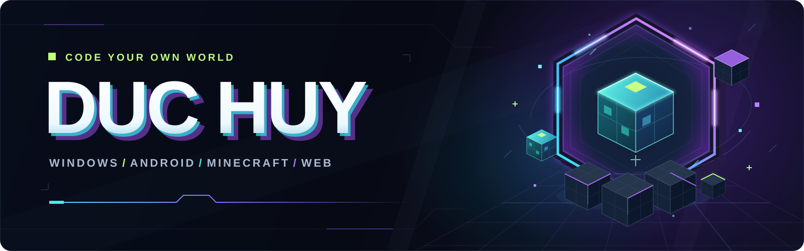

  

<h1 align="center">Xin chào, mình là Bùi Đức Huy 👋</h1>

  <b>Nhà phát triển Phần mềm Độc lập & Mã nguồn mở (Windows Desktop · Android · Minecraft Ecosystem · Rust · Web)</b> 
  <i>Tập trung xây dựng những công cụ hệ thống siêu nhẹ, tối ưu hiệu năng phần cứng và giao diện kính trong suốt mượt mà.</i>

  
  
  
  
  

---

## 🌟 Hệ Sinh Thái Dự Án Nổi Bật (Featured Open-Source Projects)

<table>
  <tr>
    <td width="50%" valign="top">
      <h3>🚀 <a href="https://github.com/buiduchuy2010qn-prog/blockway-launcher">BlockWay Launcher v42.4.0 PRO</a></h3>
      

        
        
        
      

      
Trình khởi chạy <b>Minecraft: Java Edition</b> giao diện kính <b>120Hz Pure Horizon Glass</b> hợp nhất <b>8 Core Loaders</b> (7 Loader Java + nhân <b>🦀 Horizon Rust</b> Vulkan/DX12), nén RAM <code>HeapCompact</code>, Java 25 Compact Headers, AppCDS, Smooth v5 (<code>1.8.9–26.3</code>) và kho Modrinth/CurseForge.

      
<a href="https://buiduchuy2010qn-prog.github.io/blockway-launcher/">🌐 Trang chủ</a> · <a href="https://github.com/buiduchuy2010qn-prog/blockway-launcher/releases/latest">📥 Tải bản phát hành</a> · <a href="https://github.com/buiduchuy2010qn-prog/blockway-launcher/blob/main/NOTICE.md">📜 NOTICE</a>

    </td>
    <td width="50%" valign="top">
      <h3>📱 <a href="https://github.com/buiduchuy2010qn-prog/minehost-android">MineHost Pro v3.2.1 (Android Server)</a></h3>
      

        
        
        
      

      
Ứng dụng mở máy chủ <b>Minecraft Java & Bedrock PE</b> trên điện thoại Android với giao diện pha lê trong suốt <b>Pure Horizon Glass (26%)</b>, tích hợp <b>3 chế độ nhân</b> (Java Mod • Java Turbo • Pumpkin Rust thuần 0% Java), Crossplay GeyserMC + Floodgate và đường hầm Playit.gg.

      
<a href="https://github.com/buiduchuy2010qn-prog/minehost-android/releases/latest">📥 Tải APK v3.2.1</a> · <a href="https://github.com/buiduchuy2010qn-prog/minehost-android/blob/main/NOTICE">📜 Bản quyền & NOTICE</a>

    </td>
  </tr>
  <tr>
    <td width="50%" valign="top">
      <h3>☁️ <a href="https://github.com/buiduchuy2010qn-prog/kumo">Kumo Desktop</a></h3>
      

        
        
        
      

      
Thanh <b>Dynamic Island</b> nguyên bản siêu nhẹ (~255 KB) cho Windows 10/11 viết bằng C# & Win32 API (<code>UpdateLayeredWindow</code>, <code>PerMonitorV2</code> DPI). Hỗ trợ sóng nhạc WASAPI 60 FPS, lời bài hát Karaoke đồng bộ từ LRCLIB, lịch tháng, thời tiết, kệ tệp kéo-thả và Pomodoro.

      
<a href="https://buiduchuy2010qn-prog.github.io/kumo/">🌐 Trang chủ & Mô phỏng</a> · <a href="https://github.com/buiduchuy2010qn-prog/kumo/releases/latest">📥 Tải bộ cài (.exe)</a>

    </td>
    <td width="50%" valign="top">
      <h3>🦀 <a href="https://github.com/buiduchuy2010qn-prog/blockway-rust-engine">BlockWay Multi-Version Rust Engine</a></h3>
      

        
        
        
      

      
Nhân <b>Minecraft: Java Edition viết bằng Rust</b> mở rộng từ <code>horizon-rust/horizon</code>: hỗ trợ 29 phiên bản <code>1.16.5 → 26.3</code>, nén RAM Windows <code>HeapCompact</code> + <code>mimalloc</code> v3, ưu tiên nhân <code>P-Core</code> / chống <code>EcoQoS</code> và bộ chuyển đổi gói Mod <code>horizon-port-jar</code>.

      
<a href="https://github.com/buiduchuy2010qn-prog/blockway-rust-engine/blob/main/BLOCKWAY_RUST.md">📖 Kiến trúc kỹ thuật</a> · <a href="https://github.com/buiduchuy2010qn-prog/blockway-rust-engine/blob/main/NOTICE.md">📜 NOTICE</a>

    </td>
  </tr>
  <tr>
    <td width="50%" valign="top">
      <h3>⚡ <a href="https://github.com/buiduchuy2010qn-prog/SmoothMineLauncher">SmoothMine Launcher (Android)</a></h3>
      

        
        
        
      

      
Trình khởi chạy <b>Minecraft: Java Edition</b> cho Android tối ưu FPS chuyên sâu: tự động nhận diện GPU (Adreno/Mali/Vulkan), phân bổ ngưỡng RAM chống văng game (<code>lmkd</code>) và cài đặt 1-chạm bộ Mod tăng FPS (Sodium, Lithium, FerriteCore).

      
<a href="https://github.com/buiduchuy2010qn-prog/SmoothMineLauncher/releases/latest">📥 Tải APK mới nhất</a> · <a href="https://github.com/buiduchuy2010qn-prog/SmoothMineLauncher/blob/v3_openjdk/NOTICE.md">📜 NOTICE</a>

    </td>
    <td width="50%" valign="top">
      <h3>📲 <a href="https://github.com/buiduchuy2010qn-prog/nova-mobile-os">NovaOS 16 Hybrid Lite</a> & <a href="https://github.com/buiduchuy2010qn-prog/xe-tui-mu">Web Apps</a></h3>
      

        
        
        
      

      
Hệ thống đóng gói ROM tùy biến (<code>system.img</code> DSU song song 0% rủi ro cho Xiaomi 8) trên GitHub Actions, cùng các bản Việt hóa & nâng cấp mã nguồn mở (<a href="https://github.com/buiduchuy2010qn-prog/misterdownloadmanager">Mister Download Manager</a>, <a href="https://github.com/buiduchuy2010qn-prog/Mochy-Music">Mochy Music</a>, <a href="https://github.com/buiduchuy2010qn-prog/Dolphy-App">Dolphy App</a>) và mini-game <a href="https://xe-tui-mu.vercel.app">Xé Túi Mù</a>.

    </td>
  </tr>
</table>

---

## 🛠️ Công Nghệ & Nền Tảng (Tech Stack)

  
  
  
  
  
  
  
  
  
  

---

## 📜 Bảng Minh Bạch Giấy Phép & Bản Quyền Mã Nguồn Mở (Licensing & Attribution)

Mọi kho mã nguồn công khai trên tài khoản `@buiduchuy2010qn-prog` đều tuân thủ nghiêm ngặt các giấy phép mã nguồn mở quốc tế (`MIT`, `GNU GPL-3.0`, `GNU LGPL-3.0`) và ghi nhận đầy đủ bản quyền tác giả gốc:

| Repository | Phiên bản mới nhất | Giấy phép (SPDX) | Tác giả / Nguồn kế thừa (Upstream Attribution) | Văn bản Pháp lý |
| :--- | :---: | :---: | :--- | :---: |
| **[blockway-launcher](https://github.com/buiduchuy2010qn-prog/blockway-launcher)** | `v42.4.0 PRO` | `MIT` | © 2026 **Bùi Đức Huy (`@buiduchuy2010qn-prog`)** · Nhân `rust-engine/` kế thừa từ **[horizon-rust/horizon](https://github.com/horizon-rust/horizon)** (© Ludovic Marie & Horizon contributors) | [LICENSE](https://github.com/buiduchuy2010qn-prog/blockway-launcher/blob/main/LICENSE) · [NOTICE](https://github.com/buiduchuy2010qn-prog/blockway-launcher/blob/main/NOTICE.md) |
| **[blockway-rust-engine](https://github.com/buiduchuy2010qn-prog/blockway-rust-engine)** | `v2.1.0` | `MIT` | Kế thừa từ **[horizon-rust/horizon](https://github.com/horizon-rust/horizon)** (© Ludovic Marie & contributors); phần mở rộng đa phiên bản & `HeapCompact` © 2026 **Bùi Đức Huy** | [LICENSE](https://github.com/buiduchuy2010qn-prog/blockway-rust-engine/blob/main/LICENSE) · [NOTICE](https://github.com/buiduchuy2010qn-prog/blockway-rust-engine/blob/main/NOTICE.md) |
| **[minehost-android](https://github.com/buiduchuy2010qn-prog/minehost-android)** | `v3.2.1` (`b74`) | `GPL-3.0-or-later` | Kế thừa nền tảng từ **[lovehutaocute/Minexa](https://github.com/lovehutaocute/Minexa)**; nâng cấp Pure Horizon Glass & 3-Engine © 2026 **Bùi Đức Huy** | [LICENSE](https://github.com/buiduchuy2010qn-prog/minehost-android/blob/main/LICENSE) · [NOTICE](https://github.com/buiduchuy2010qn-prog/minehost-android/blob/main/NOTICE) |
| **[SmoothMineLauncher](https://github.com/buiduchuy2010qn-prog/SmoothMineLauncher)** | `v1.1.1` | `LGPL-3.0` | Kế thừa từ **PojavLauncherTeam** & **[AngelAuraMC/Amethyst-Android](https://github.com/AngelAuraMC/Amethyst-Android)**; tối ưu SmoothBoost © 2026 **Bùi Đức Huy** | [LICENSE](https://github.com/buiduchuy2010qn-prog/SmoothMineLauncher/blob/v3_openjdk/LICENSE) · [NOTICE](https://github.com/buiduchuy2010qn-prog/SmoothMineLauncher/blob/v3_openjdk/NOTICE.md) |
| **[kumo](https://github.com/buiduchuy2010qn-prog/kumo)** | `v1.1.28` | `MIT` | © 2026 **Bùi Đức Huy (`@buiduchuy2010qn-prog`)** (Cảm hứng ý tưởng từ [@rama2555/nusa](https://github.com/rama2555/nusa)) | [LICENSE](https://github.com/buiduchuy2010qn-prog/kumo/blob/main/LICENSE) |
| **[misterdownloadmanager](https://github.com/buiduchuy2010qn-prog/misterdownloadmanager)** | `v0.5.5` | `GPL-3.0-or-later` | Tác phẩm gốc © **Ahmed Nefzaoui** ([anefzaoui/misterdownloadmanager](https://github.com/anefzaoui/misterdownloadmanager)); bản fork nâng cấp © 2026 **Bùi Đức Huy** | [LICENSE](https://github.com/buiduchuy2010qn-prog/misterdownloadmanager/blob/main/LICENSE) · [NOTICE](https://github.com/buiduchuy2010qn-prog/misterdownloadmanager/blob/main/NOTICE.md) |
| **[Mochy-Music](https://github.com/buiduchuy2010qn-prog/Mochy-Music)** | `v10.0.0-b1255` | `GPL-3.0` | Tác giả gốc **P ASHOKAN (`@realidkroo`)** & **`@realkeichi`**, nền tảng `@vivizzz007` & `@mostafaalagamy`; Việt hóa & OTA © 2026 **Bùi Đức Huy** | [LICENSE](https://github.com/buiduchuy2010qn-prog/Mochy-Music/blob/main/LICENSE) · [NOTICE](https://github.com/buiduchuy2010qn-prog/Mochy-Music/blob/main/NOTICE.md) |
| **[Dolphy-App](https://github.com/buiduchuy2010qn-prog/Dolphy-App)** | `v3.1-vn` | `GPL-3.0` | Tác giả gốc **[unvoiddd/Dolphy-App](https://github.com/unvoiddd/Dolphy-App)** (ZalexDev, ars3nb, Astrocodee); bản Việt hóa © 2026 **Bùi Đức Huy** | [LICENSE](https://github.com/buiduchuy2010qn-prog/Dolphy-App/blob/main/LICENSE) · [NOTICE](https://github.com/buiduchuy2010qn-prog/Dolphy-App/blob/main/NOTICE.md) |
| **[nova-mobile-os](https://github.com/buiduchuy2010qn-prog/nova-mobile-os)** | `v16.0-vn` | `MIT` | © 2026 **Bùi Đức Huy** (Nghiên cứu dựa trên **Android Open Source Project - AOSP**) | [LICENSE](https://github.com/buiduchuy2010qn-prog/nova-mobile-os/blob/main/LICENSE) |
| **[xe-tui-mu](https://github.com/buiduchuy2010qn-prog/xe-tui-mu)** · **[nacachuacute](https://github.com/buiduchuy2010qn-prog/nacachuacute)** · **[webtotinh](https://github.com/buiduchuy2010qn-prog/webtotinh)** | Web Live | `MIT` | © 2026 **Bùi Đức Huy (`@buiduchuy2010qn-prog`)** | [LICENSE](https://github.com/buiduchuy2010qn-prog/xe-tui-mu/blob/main/LICENSE) |

> **⚖️ Tuyên bố Nhãn hiệu & Miễn trừ Trách nhiệm (Trademark & Non-Affiliation Disclaimer):**
> - **NOT AN OFFICIAL MINECRAFT PRODUCT. NOT APPROVED BY OR ASSOCIATED WITH MOJANG OR MICROSOFT.**
> - **Minecraft** là nhãn hiệu đã đăng ký của **Mojang Synergies AB / Microsoft Corporation**; **Windows** là nhãn hiệu của **Microsoft Corporation**; **Android** là nhãn hiệu của **Google LLC**; **Dynamic Island** là nhãn hiệu của **Apple Inc.**
> - Toàn bộ các kho mã nguồn tại đây là dự án độc lập phục vụ mục đích học tập, nghiên cứu kỹ thuật và cộng đồng, được cung cấp nguyên trạng (*"AS IS"*) không kèm theo bất kỳ bảo đảm thương mại nào.

---

  <b>Build something useful. Make it fun. Respect open source.</b> 
  © 2026 Bùi Đức Huy (<a href="https://github.com/buiduchuy2010qn-prog">@buiduchuy2010qn-prog</a>) · Phát hành theo giấy phép <a href="./LICENSE">MIT License</a>

