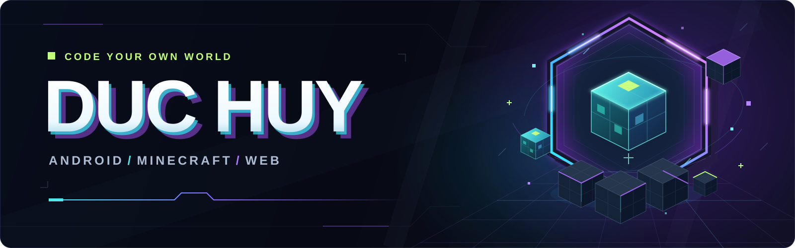

  

<h1 align="center">Chào bạn, mình là Huy 👋</h1>

  Mình xây dựng ứng dụng Android, công cụ Minecraft và những dự án web thú vị. 
  Từ quản lý server trên điện thoại đến launcher trên máy tính — mỗi dự án là một cơ hội để học và thử điều mới.

  <a href="https://github.com/buiduchuy2010qn-prog?tab=repositories">Khám phá các dự án</a>
  &nbsp;·&nbsp;
  <a href="https://github.com/buiduchuy2010qn-prog/minehost-android/releases">Tải MineHost</a>
  &nbsp;·&nbsp;
  <a href="https://xe-tui-mu.vercel.app">Chơi Xé túi mù</a>

## 🧩 Mình đang xây dựng

- **Android:** ứng dụng và tiện ích chạy ngay trên điện thoại.
- **Minecraft:** công cụ quản lý server và launcher cho người chơi.
- **Web:** những trải nghiệm tương tác nhỏ, vui và dễ khám phá.

## 🛠️ Công nghệ trong các dự án

  
  
  
  
  
  

## 🚀 Dự án nổi bật

| Dự án | Giới thiệu | Công nghệ |
| :--- | :--- | :--- |
| **[📱 MineHost Android](https://github.com/buiduchuy2010qn-prog/minehost-android)** | Tạo và quản trị máy chủ Minecraft Java & Bedrock ngay trên điện thoại Android. | Kotlin · Jetpack Compose |
| **[🌌 Aether Mine Launcher](https://github.com/buiduchuy2010qn-prog/aether-mine-launcher)** | Launcher Minecraft cho Windows, với giao diện xây dựng bằng công nghệ web. | Electron · JavaScript |
| **[🎁 Xé túi mù](https://github.com/buiduchuy2010qn-prog/xe-tui-mu)** | Game web xé túi mù giải trí. **[Chơi thử ↗](https://xe-tui-mu.vercel.app)** | React · Vite |

---

  <b>Build something useful. Make it fun.</b> 
  Cảm ơn bạn đã ghé thăm — hẹn gặp trong những dự án tiếp theo!

