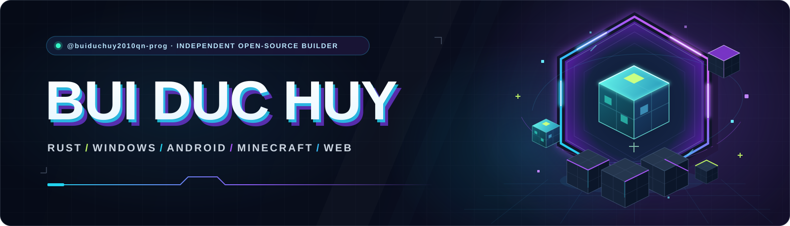
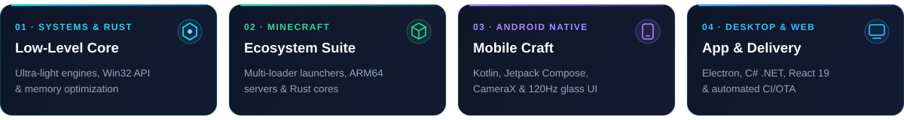

  <picture>
    <source media="(prefers-color-scheme: dark)" srcset="./assets/banner-dark.svg" />
    <source media="(prefers-color-scheme: light)" srcset="./assets/banner-light.svg" />
    
  </picture>

<h1 align="center">Xin chào, mình là Bùi Đức Huy 👋</h1>

  <b>Nhà phát triển Phần mềm Độc lập &amp; Mã nguồn mở (Rust · Windows · Android · Minecraft · Web)</b> 
  <i>Tập trung vào công cụ hệ thống siêu nhẹ, tối ưu phần cứng và giao diện kính trong suốt 120Hz Pure Horizon Glass.</i>

  
  
  

  <picture>
    <source media="(prefers-color-scheme: dark)" srcset="./assets/pillars-dark.svg" />
    <source media="(prefers-color-scheme: light)" srcset="./assets/pillars-light.svg" />
    
  </picture>

---

## 🌟 Dự Án Chủ Lực (Flagship Projects)

<table>
  <tr>
    <td width="50%" valign="top">
      <h3>🚀 <a href="https://github.com/buiduchuy2010qn-prog/blockway-launcher">BlockWay Launcher</a></h3>
      

        
        
        
      

      
Trình khởi chạy <b>Minecraft: Java Edition</b> (Electron 45) giao diện kính <b>120Hz Pure Horizon Glass</b> hợp nhất 8 Core Loaders, nhân Rust khởi chạy &lt;1s, đệm Microsoft OAuth 0ms, <code>HeapCompact</code> và kho Modrinth.

      
<a href="https://buiduchuy2010qn-prog.github.io/blockway-launcher/">🌐 Trang chủ</a> · <a href="https://github.com/buiduchuy2010qn-prog/blockway-launcher/releases/latest">📥 Tải bản phát hành</a> · <a href="https://github.com/buiduchuy2010qn-prog/blockway-launcher/blob/main/NOTICE.md">📜 NOTICE</a>

    </td>
    <td width="50%" valign="top">
      <h3>📱 <a href="https://github.com/buiduchuy2010qn-prog/minehost-android">MineHost Pro</a></h3>
      

        
        
        
      

      
Ứng dụng mở máy chủ <b>Minecraft Java &amp; Bedrock PE</b> trực tiếp trên Android ARM64 với 3 chế độ nhân (Java Mod · Java Turbo · Pumpkin Rust 0% Java), Crossplay GeyserMC và Playit.gg.

      
<a href="https://github.com/buiduchuy2010qn-prog/minehost-android/releases/latest">📥 Tải APK v3.3.0</a> · <a href="https://github.com/buiduchuy2010qn-prog/minehost-android/blob/main/NOTICE">📜 NOTICE</a>

    </td>
  </tr>
  <tr>
    <td width="50%" valign="top">
      <h3>☁️ <a href="https://github.com/buiduchuy2010qn-prog/kumo">Kumo Desktop</a></h3>
      

        
        
        
      

      
Thanh <b>Dynamic Island</b> siêu nhẹ (~255 KB) viết thuần C# &amp; Win32 API (<code>UpdateLayeredWindow</code>, <code>PerMonitorV2</code>) với sóng nhạc WASAPI 60 FPS, Karaoke LRCLIB, lịch tháng, kệ tệp và Pomodoro.

      
<a href="https://buiduchuy2010qn-prog.github.io/kumo/">🌐 Trang chủ</a> · <a href="https://github.com/buiduchuy2010qn-prog/kumo/releases/latest">📥 Tải bộ cài (.exe)</a>

    </td>
    <td width="50%" valign="top">
      <h3>🦀 <a href="https://github.com/buiduchuy2010qn-prog/blockway-rust-engine">BlockWay Rust Engine</a></h3>
      

        
        
        
      

      
Nhân <b>Minecraft viết bằng Rust</b> mở rộng từ <code>horizon-rust/horizon</code>: hỗ trợ 29 phiên bản <code>1.16.5 → 26.3</code>, nén RAM <code>HeapCompact</code> + <code>mimalloc</code> v3, ưu tiên <code>P-Core</code> và bộ chuyển <code>horizon-port-jar</code>.

      
<a href="https://github.com/buiduchuy2010qn-prog/blockway-rust-engine/blob/main/BLOCKWAY_RUST.md">📖 Kiến trúc</a> · <a href="https://github.com/buiduchuy2010qn-prog/blockway-rust-engine/blob/main/NOTICE.md">📜 NOTICE</a>

    </td>
  </tr>
  <tr>
    <td colspan="2" valign="top">
      <h3>⚡ <a href="https://github.com/buiduchuy2010qn-prog/SmoothMineLauncher">SmoothMine Launcher</a></h3>
      

        
        
        
      

      
Trình khởi chạy <b>Minecraft: Java Edition</b> trên Android tối ưu FPS: nhận diện GPU Adreno/Mali/Vulkan, phân bổ RAM chống <code>lmkd</code> và cài 1-chạm gói Mod tăng tốc Sodium, Lithium, FerriteCore.

      
<a href="https://github.com/buiduchuy2010qn-prog/SmoothMineLauncher/releases/latest">📥 Tải APK</a> · <a href="https://github.com/buiduchuy2010qn-prog/SmoothMineLauncher/blob/v3_openjdk/NOTICE.md">📜 NOTICE</a>

    </td>
  </tr>
</table>

---

## 🧩 Bản Fork Cộng Đồng, Việt Hóa & Web Apps

| Dự án | Phát hành | Giấy phép | Mô tả |
| :--- | :---: | :---: | :--- |
| **[Mochy-Music](https://github.com/buiduchuy2010qn-prog/Mochy-Music)** |  | `GPL-3.0` | Trình nghe nhạc Android / Windows / Linux Việt hóa toàn diện, không quảng cáo &amp; hỗ trợ OTA. |
| **[misterdownloadmanager](https://github.com/buiduchuy2010qn-prog/misterdownloadmanager)** |  | `GPL-3.0-or-later` | Trình quản lý tải xuống đa luồng viết bằng Rust kèm tiện ích trình duyệt Chromium / Firefox &amp; OTA. |
| **[Dolphy-App](https://github.com/buiduchuy2010qn-prog/Dolphy-App)** |  | `GPL-3.0` | Bộ công cụ Android nghiên cứu giao thức không dây NFC, BLE &amp; Hồng ngoại (bản Việt hóa). |
| **[FlClash](https://github.com/buiduchuy2010qn-prog/FlClash)** |  | `GPL-3.0` | Ứng dụng Proxy ClashMeta (`mihomo`) mã nguồn mở cho Android, bản Việt hóa APK không quảng cáo. |
| **[nova-mobile-os](https://github.com/buiduchuy2010qn-prog/nova-mobile-os)** | [`v16.0-vn`](https://github.com/buiduchuy2010qn-prog/nova-mobile-os/releases/tag/v16.0-vn) | `MIT` | Đóng gói ROM Android 16 Hybrid Lite (<code>system.img</code> DSU Dual-Boot không xóa ROM gốc) cho Xiaomi 8. |
| **[xe-tui-mu](https://github.com/buiduchuy2010qn-prog/xe-tui-mu)** | [Live Web](https://xe-tui-mu.vercel.app) | `MIT` | Trò chơi web xé túi mù giải trí tương tác xây dựng với React 19, Vite &amp; Tailwind CSS. |
| **[nacachuacute](https://github.com/buiduchuy2010qn-prog/nacachuacute)** · **[webtotinh](https://github.com/buiduchuy2010qn-prog/webtotinh)** | [Na Cà Chua](https://buiduchuy2010qn-prog.github.io/nacachuacute/) · [Web Tỏ Tình](https://buiduchuy2010qn-prog.github.io/webtotinh/) | `MIT` | Mini-game Blind Box phong cách Doodle &amp; thiệp tương tác hoạt họa phát hành qua GitHub Pages. |

---

## 🛠️ Công Nghệ Sử Dụng (Tech Stack)

  
  
  
  
  
  
   
  
  
  
  
  
  

---

## 📜 Minh Bạch Giấy Phép & Ghi Công (Licensing & Attribution)

<b>Bảng tổng hợp giấy phép, bản quyền upstream &amp; liên kết pháp lý của toàn bộ kho mã nguồn</b>

 

| Repository / Phát hành | Giấy phép (SPDX) | Nguồn kế thừa &amp; Bản quyền (Attribution) | Văn bản Pháp lý |
| :--- | :---: | :--- | :---: |
| **[buiduchuy2010qn-prog](https://github.com/buiduchuy2010qn-prog/buiduchuy2010qn-prog)** | `MIT` | © 2026 **Bùi Đức Huy (`@buiduchuy2010qn-prog`)** — Hồ sơ cá nhân &amp; tài nguyên SVG | [LICENSE](./LICENSE) |
| **[blockway-launcher](https://github.com/buiduchuy2010qn-prog/blockway-launcher)** | `MIT` | © 2026 **Bùi Đức Huy** · `rust-engine/` kế thừa từ **[horizon-rust/horizon](https://github.com/horizon-rust/horizon)** ở các bản snapshot trước `2026-11-15` (giai đoạn upstream áp dụng `MIT`, trước PR `#17111` chuyển sang `LGPL-3.0-or-later`) | [LICENSE](https://github.com/buiduchuy2010qn-prog/blockway-launcher/blob/main/LICENSE) · [NOTICE](https://github.com/buiduchuy2010qn-prog/blockway-launcher/blob/main/NOTICE.md) |
| **[blockway-rust-engine](https://github.com/buiduchuy2010qn-prog/blockway-rust-engine)** | `MIT` | Kế thừa **[horizon-rust/horizon](https://github.com/horizon-rust/horizon)** (© Ludovic Marie &amp; Horizon contributors, snapshot trước `2026-11-15` theo `MIT`); phần đa phiên bản &amp; `HeapCompact` © 2026 **Bùi Đức Huy** | [LICENSE](https://github.com/buiduchuy2010qn-prog/blockway-rust-engine/blob/main/LICENSE) · [NOTICE](https://github.com/buiduchuy2010qn-prog/blockway-rust-engine/blob/main/NOTICE.md) |
| **[minehost-android](https://github.com/buiduchuy2010qn-prog/minehost-android)** | `GPL-3.0-or-later` | Kế thừa **[lovehutaocute/Minexa](https://github.com/lovehutaocute/Minexa)**; điều phối **[Pumpkin-MC/Pumpkin](https://github.com/Pumpkin-MC/Pumpkin)** (`GPL-3.0`), GeyserMC (`MIT`); nâng cấp © 2026 **Bùi Đức Huy** | [LICENSE](https://github.com/buiduchuy2010qn-prog/minehost-android/blob/main/LICENSE) · [NOTICE](https://github.com/buiduchuy2010qn-prog/minehost-android/blob/main/NOTICE) |
| **[SmoothMineLauncher](https://github.com/buiduchuy2010qn-prog/SmoothMineLauncher)** | `LGPL-3.0` | Kế thừa **PojavLauncherTeam** &amp; **[AngelAuraMC/Amethyst-Android](https://github.com/AngelAuraMC/Amethyst-Android)**; tối ưu SmoothBoost © 2026 **Bùi Đức Huy** | [LICENSE](https://github.com/buiduchuy2010qn-prog/SmoothMineLauncher/blob/v3_openjdk/LICENSE) · [NOTICE](https://github.com/buiduchuy2010qn-prog/SmoothMineLauncher/blob/v3_openjdk/NOTICE.md) |
| **[kumo](https://github.com/buiduchuy2010qn-prog/kumo)** | `MIT` | © 2026 **Bùi Đức Huy (`@buiduchuy2010qn-prog`)** · Cảm hứng ý tưởng từ [@rama2555/nusa](https://github.com/rama2555/nusa) | [LICENSE](https://github.com/buiduchuy2010qn-prog/kumo/blob/main/LICENSE) |
| **[misterdownloadmanager](https://github.com/buiduchuy2010qn-prog/misterdownloadmanager)** | `GPL-3.0-or-later` | Tác phẩm gốc © 2026 **Ahmed Nefzaoui** ([anefzaoui/misterdownloadmanager](https://github.com/anefzaoui/misterdownloadmanager)); bản fork nâng cấp © 2026 **Bùi Đức Huy** | [LICENSE](https://github.com/buiduchuy2010qn-prog/misterdownloadmanager/blob/main/LICENSE) · [NOTICE](https://github.com/buiduchuy2010qn-prog/misterdownloadmanager/blob/main/NOTICE.md) |
| **[Mochy-Music](https://github.com/buiduchuy2010qn-prog/Mochy-Music)** | `GPL-3.0` | Tác giả gốc **P ASHOKAN (`@realidkroo`)** &amp; **`@realkeichi`** (trên nền `@vivizzz007` &amp; `@mostafaalagamy`); Việt hóa &amp; OTA © 2026 **Bùi Đức Huy** | [LICENSE](https://github.com/buiduchuy2010qn-prog/Mochy-Music/blob/main/LICENSE) · [NOTICE](https://github.com/buiduchuy2010qn-prog/Mochy-Music/blob/main/NOTICE.md) |
| **[Dolphy-App](https://github.com/buiduchuy2010qn-prog/Dolphy-App)** | `GPL-3.0` | Tác giả gốc **[unvoiddd/Dolphy-App](https://github.com/unvoiddd/Dolphy-App)** (ZalexDev, ars3nb, Astrocodee); bản Việt hóa © 2026 **Bùi Đức Huy** | [LICENSE](https://github.com/buiduchuy2010qn-prog/Dolphy-App/blob/main/LICENSE) · [NOTICE](https://github.com/buiduchuy2010qn-prog/Dolphy-App/blob/main/NOTICE.md) |
| **[FlClash](https://github.com/buiduchuy2010qn-prog/FlClash)** | `GPL-3.0` | Tác giả gốc **[chen08209/FlClash](https://github.com/chen08209/FlClash)** (nhân `mihomo` / Clash.Meta); bản Việt hóa APK © 2026 **Bùi Đức Huy** | [LICENSE](https://github.com/buiduchuy2010qn-prog/FlClash/blob/main/LICENSE) · [NOTICE](https://github.com/buiduchuy2010qn-prog/FlClash/blob/main/NOTICE.md) |
| **[nova-mobile-os](https://github.com/buiduchuy2010qn-prog/nova-mobile-os)** | `MIT` | © 2026 **Bùi Đức Huy** (AOSP research) · Release `v16.0-vn` có kèm APK từ **[Lawnchair](https://github.com/LawnchairLauncher/lawnchair)** (`Apache-2.0`) | [LICENSE](https://github.com/buiduchuy2010qn-prog/nova-mobile-os/blob/main/LICENSE) |
| **[xe-tui-mu](https://github.com/buiduchuy2010qn-prog/xe-tui-mu)** | `MIT` | © 2026 **Bùi Đức Huy (`@buiduchuy2010qn-prog`)** | [LICENSE](https://github.com/buiduchuy2010qn-prog/xe-tui-mu/blob/main/LICENSE) |
| **[nacachuacute](https://github.com/buiduchuy2010qn-prog/nacachuacute)** · **[webtotinh](https://github.com/buiduchuy2010qn-prog/webtotinh)** | `MIT` | © 2026 **Bùi Đức Huy (`@buiduchuy2010qn-prog`)** | [LICENSE (Na Cà Chua)](https://github.com/buiduchuy2010qn-prog/nacachuacute/blob/main/LICENSE) · [LICENSE (Web Tỏ Tình)](https://github.com/buiduchuy2010qn-prog/webtotinh/blob/main/LICENSE) |

> **⚖️ Tuyên bố Nhãn hiệu &amp; Miễn trừ Trách nhiệm (Trademark &amp; Non-Affiliation Disclaimer):**
> - **NOT AN OFFICIAL MINECRAFT PRODUCT. NOT APPROVED BY OR ASSOCIATED WITH MOJANG OR MICROSOFT.**
> - **Minecraft** là nhãn hiệu đã đăng ký của **Mojang Synergies AB / Microsoft Corporation**; **Windows** là nhãn hiệu của **Microsoft Corporation**; **Android** là nhãn hiệu của **Google LLC**; **Dynamic Island** là nhãn hiệu của **Apple Inc.**
> - Toàn bộ các kho mã nguồn và bản phát hành tại đây là dự án độc lập phục vụ mục đích học tập, nghiên cứu kỹ thuật và cộng đồng, không liên kết hay được chứng thực bởi các tổ chức trên và được cung cấp nguyên trạng (*"AS IS"*) không kèm bảo đảm thương mại.

---

  <b>Build something useful. Make it fun. Respect open source.</b> 
  © 2026 Bùi Đức Huy (<a href="https://github.com/buiduchuy2010qn-prog">@buiduchuy2010qn-prog</a>) · Phát hành theo giấy phép <a href="./LICENSE">MIT License</a>

